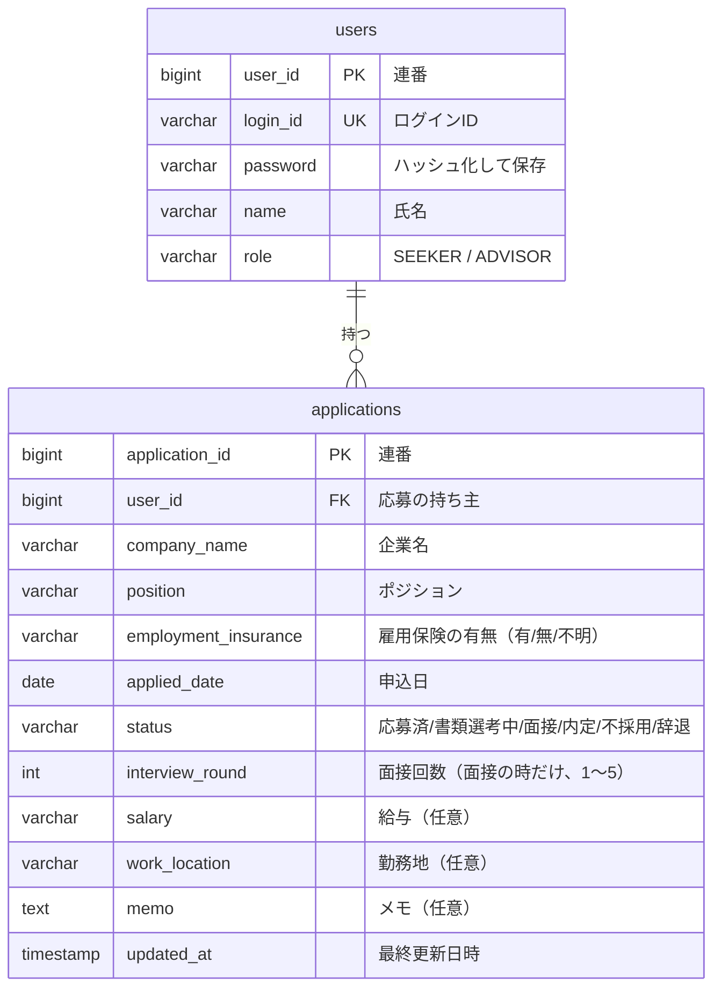

> [!NOTE]
> これは考査提出用のサンプルアプリです。

# Jobflow Tracker（就活管理アプリ）

応募から内定までの選考の進み具合を、ひと目で確認できるようにするアプリです。
求職者は自分の応募を記録し、就職支援の担当者は求職者ごとの活動状況を一覧で確認できます。

## 開発した背景

就職活動では、応募先ごとに企業名・ポジション・雇用保険の有無・選考の段階を管理する必要があります。
私自身、週に一度の活動報告で毎回同じ項目を書き写していて、応募が増えるほど転記の手間と書き漏れが増えていました。

このアプリは応募の情報を一か所にまとめ、選考が進んだらその応募を開いて更新するだけで済むようにするためのものです。
あわせて、求職者を支援する担当者が全員の状況を一覧で確認し、活動が止まっている人を早めに見つけられるようにしています。

工夫した点や、作りながら見つけた抜けは、下の「開発の記録」にまとめています。

## 利用者

| 利用者 | できること | 想定する環境 |
|---|---|---|
| 求職者 | ユーザー登録、自分の応募の登録・閲覧・編集・削除 | スマートフォンの Chrome |
| 担当者 | 全求職者の応募の閲覧（登録・編集・削除はしない） | PC の Chrome |

担当者のアカウントは初期データで用意します。ユーザー登録で作れるのは求職者のアカウントだけです。

## 主な機能

- ユーザー登録、ログイン、ログアウト
- 応募の一覧・詳細・登録・編集・削除（求職者は自分の応募だけ操作できる）
- 担当者用の求職者一覧（氏名・応募件数・最終更新日）と、求職者ごとの応募一覧
- 選考の段階は「面接」を1つにまとめ、何次面接かを回数（1〜5）で持つ。画面では「二次面接」のように表示する
- 担当者用の求職者一覧は「最終更新日の古い順」に並べ替えられる。応募が0件の人と、更新が止まっている人が上に来る
- 担当者の画面には「管理No」を出し、同姓同名の求職者を見分けられるようにしている
- 画面は端末の設定に合わせてダークモードに切り替わる

## デモ画像

<!-- TODO: 全画面のスクリーンショットを貼る（本番 URL を出さないので必須）。各画像に一言。
- ログイン画面
- ユーザー登録画面
- 応募一覧画面
- 応募登録画面
- 応募詳細画面
- 応募編集画面
- 担当者用一覧画面
- 求職者別応募画面
-->

## 使用技術

| 分類 | 技術 |
|---|---|
| フロントエンド | JavaScript, React 19, Vite 8, React Router |
| バックエンド | Java 21, Spring Boot 4, Spring Data JPA |
| 認証 | Spring Security（セッション方式） |
| データベース | H2（ファイルに保存） |
| ビルド | Maven（Maven Wrapper）, npm |
| テスト | JUnit, Spring Boot Test（MockMvc） |
| 設計 | draw.io |
| その他 | Git, GitHub, Postman |

## ER 図



- 1人の求職者は0件以上の応募を持ちます（1対多）
- 担当者も `users` に入れ、`role` で求職者と区別します。担当者は応募を持ちません
- 面接の日程や結果の履歴が必要になったら、選考の段階を別のテーブルに分ける想定です。今回は回数の列だけにしています

## 設計書

実装の前に作った設計書を `docs/` に置いています。draw.io（https://app.diagrams.net/）で開けます。

- `docs/基本設計.drawio`: システム構成図、画面遷移図、ER 図
- `docs/詳細設計.drawio`: 画面ごとのワイヤーフレームと画面設計書（8画面）

設計書を作った後に、給与・勤務地・メモの項目と、ログイン中の利用者を返す API（`GET /api/users/me`）を足しました。設計書の ER 図にはこの3項目が入っていないので、最新の形は上の ER 図を見てください。

## 設計で決めたこと

- 他人の応募 ID を指定されたときは、403 ではなく 404 を返します。応募が存在すること自体を知らせないためです。応募の取得・更新・削除では、ログイン中のユーザーが持ち主かをサーバー側で確かめます
- 認証は JWT ではなく、Spring Security のセッション方式にしました。サーバーは1台で、JWT の利点（サーバーを増やしても状態を持たなくてよい、別のドメインやアプリと共有できる）が活きません。セッションならログアウトでサーバー側の状態を消せば即座に無効になり、Cookie を HttpOnly にすれば JavaScript から読み取られません。代わりに CSRF 対策を入れています
- ログインに失敗したときのメッセージでは、ログイン ID とパスワードのどちらが違うかを出しません。登録済みのログイン ID を推測されないためです
- ステータスはどの段階からでも別の段階に変えられます。押し間違えたときに戻せるようにするためです
- 給与と勤務地は数値ではなく自由記述にしました。求人票では「年収400〜550万円」「月給25万円〜」「応相談」など書き方がばらばらで、数値に換算させると入力しにくくなるためです。未入力でも使え、画面では `---` と表示します
- メモは担当者も閲覧できます。Web アプリに書いたものは誰が見るか分からないので、私的なことは書かない前提にしました

## セキュリティで気をつけたこと

応募先や選考の状況は、本人にとって人に見られたくない情報です。最近の情報漏洩の事例を調べ、このアプリで同じことが起きないように決めました。

- 退会者・退職者のデータを持ち続けていて漏れた例を考慮しました。このアプリでは、生年月日・電話番号・住所のような、無くても困らない個人情報は項目に入れていません
- 不正アクセスではなく、設定の誤りで外から見えていた例もありました。データベースの管理画面（H2 コンソール）は有効にしておらず、エラーの応答にも内部の情報（スタックトレース）を含めません
- 他人の会員を勝手に退会させられる不具合はログイン状態の監視だけでは防げないので、応募を読む・変える・消すときは、その応募の持ち主かをサーバー側で確かめています
- 漏れがないかを [OWASP Top 10:2025](https://owasp.org/Top10/2025/ja/) と突き合わせました。そこで見つかったものとして、ログインしたときにセッション ID を振り直す（セッション固定攻撃の対策）、ユーザー登録で送られてきた `role` を受け取らない（担当者のアカウントを勝手に作らせない）、を入れています
- ログイン失敗の回数制限と監査ログは、下の「今回の範囲外にしたもの」のとおり入れていません。総当たりの攻撃への対策が無いことは、既知の制限です

## 今回の範囲外にしたもの

検討したうえで、今回は実装しないことにした機能です。

- ログイン失敗時のロック: 5回失敗したら15分、1時間、24時間と段階的に延ばす方式を検討しました。ただ、アカウント単位でロックすると、ログイン ID を知っている第三者がわざと失敗して本人を締め出せます。ロックの単位を「ログイン ID＋接続元の IP アドレス」にすれば攻撃者の回線だけを止められますが、スマートフォンは IP が変わりやすく、同じ Wi-Fi の人が攻撃者だと本人も巻き込まれます。どちらにも穴が残るため、今回は見送りました
- 監査ログ: 担当者が誰の応募を見たか、ログインの成功・失敗を記録する機能です。記録する項目と、パスワードや入力されたログイン ID の生の値は残さないことまで決めています
- 招待コードと、担当者による登録の承認: 承認を入れると担当者に書き込みの権限が要り、「担当者は閲覧のみ」という前提が崩れるため見送りました
- パスワードにログイン ID や氏名が含まれていないかのチェック
- メール連携、カレンダー同期、通知、グラフ表示、生成 AI の API を使った入力補助

## 開発の進め方と生成 AI の使い方

企画・要件定義・基本設計・詳細設計（画面設計書、API 一覧、API 仕様書、ER 図）は自分で作り、その設計をもとに実装しました。
実装では生成 AI（Claude Code）を使い、出力されたコードを設計と照らし合わせて確認しながら進めました。
昨今の事情を考慮し、実際のニュースやOWASP等を参照してユーザー情報の保護に重点を置いて作業を行いました。

## 開発の記録

### 工夫したこと

- パスワードの文字数を、公的な指針に合わせて決めました。
  下限が無いと、短くて推測されやすいパスワードで登録されてしまいます。上限も決めておかないと長すぎる入力が思わぬ穴になります。実際にOktaでは、ログイン情報の保存に使っていたbcryptが72バイトより後ろを無視するため、52文字以上のユーザー名だと別のパスワードでも認証が通ってしまう脆弱性がありました。
  設計書では8〜64文字にしていましたが、数字に根拠がありませんでした。米国NISTのパスワードの指針（SP 800-63B-4）に「パスワードだけで認証する場合は15文字以上、上限は64文字以上を受け付ける」とあるのに合わせ、15〜64文字にしました。このアプリもbcryptを使うので、使える文字を半角英数字・記号・スペース（1文字1バイト）に限り、64文字でも72バイトを超えないようにしています。
- 実際に起きた事件から、守る場所を決めました。
  国内動画配信サービスが緊急停止し、のちに他人の会員を無断で退会させた疑いで逮捕者が出ました。このアプリでも、他人の応募を開いたり消したりできれば同じことが起きます。そこで、応募を読む・変える・消すときは、ログイン中の利用者がその応募の持ち主かをサーバー側で必ず確かめ、他人の応募は存在しない応募と同じ扱いにしています。レンタカーや飲食チェーンの事例（退会者・退職者のデータを持ち続けていた、設定の誤りで外から見えていた）からは、要らない個人情報を項目に入れないことと、管理画面を外に出さないことを決めました。
- 攻撃する側からの確認を、別のAIに任せました。
  OWASP Top10のチェックリストに沿って、実装に使ったものとは別のモデルのAIに攻撃する側として一通り試してもらい、どれも防げていることを確かめました。

### 自分の疑問から見つかった抜け

- 同姓同名の求職者: 「山田 太郎さんが2人いたらどうなる？」と考えました。データは番号で区別しているので混ざりませんが、担当者の画面には氏名しか出ていなかったため、山田 太郎さん（A）の情報を見ようとして、別の山田 太郎さん（B）の画面を開いてしまうおそれがありました。担当者の画面に「管理No」を出して見分けられるようにしました。
- 氏名を姓と名に分けるか: 検索のために分けた方がいいか迷いました。このアプリでは氏名を表示にしか使わず、名字の無い人や名前が先に来る人もいるので、1つの欄のままにしました。五十音順に並べたくなったら分けるよりフリガナの欄を足す方が合うと判断しました。
- パスワードの半角スペース: ファイル名などでは空白が嫌われるので、パスワードにも使えないものだと思っていました。調べると、NISTの指針では単語を並べたパスフレーズのためにスペースも受け付けることになっていたので、使えるようにしました。

## ローカル環境での起動方法

### 必要な環境

- Java 21（JDK）
- Node.js 20.19 以上、または 22.12 以上（Vite 8 の条件。動作確認は 24.22.1）
- Maven は不要です（`backend/` の Maven Wrapper が自動で取得します）

### バックエンド

```bash
cd backend
./mvnw spring-boot:run
```

Windows では `mvnw.cmd spring-boot:run` です。`http://127.0.0.1:8080` で起動します。
初回の起動で `backend/data/jobflow.mv.db` にデータベースが作られ、下のテスト用アカウントとデモ用の応募が入ります。最初の状態に戻したいときは、バックエンドを止めてからこのファイルを消し、もう一度起動してください。

テストは `./mvnw test` で実行できます。

### フロントエンド

バックエンドを起動したまま、別のターミナルで実行します。

```bash
cd frontend
npm ci
npm run dev
```

ブラウザで `http://localhost:5173/` を開きます。`/api` への通信は、Vite がバックエンド（8080）へ転送します。動作確認は PC の Chrome のみです。

### テスト用アカウント

ローカルで動かす練習用のアカウントです。公開された環境では使わないでください（起動時にも警告を出します）。

| 利用者 | ログイン ID | パスワード |
|---|---|---|
| 担当者 | `advisor01` | `advisor-demo-2026` |
| 求職者 | `seeker01` | `seeker-demo-2026` |

担当者の一覧に出る他の求職者（管理No 3〜8）は画面確認用のデモデータで、ログインはできません。

### 原因を調べるとき

予期しないエラーが起きたとき、通常のログには例外の種類と発生した場所だけを出しています。手元で詳しく調べるときだけ、`backend/src/main/resources/application.properties` に次の1行を足すと、例外の詳細がログに出ます。詳細には入力内容が含まれることがあるので、調べ終わったら消してください。

```properties
logging.level.com.jobflow.tracker.controller.ApiExceptionHandler=DEBUG
```
