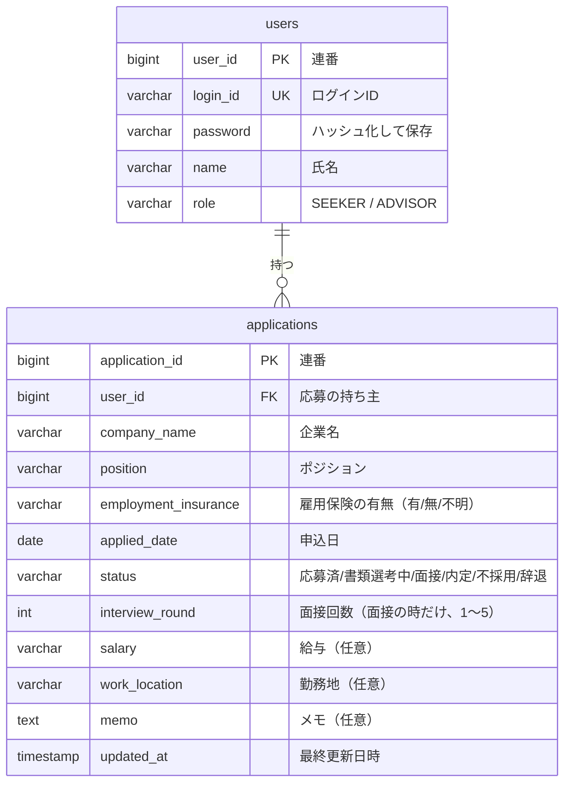

> [!NOTE]
> これは考査提出用のサンプルアプリです。

# Jobflow Tracker（就活管理アプリ）

応募から内定までの選考の進み具合を、ひと目で確認できるようにするアプリです。
求職者は自分の応募を記録し、就職支援の担当者は求職者ごとの活動状況を一覧で確認できます。

## 開発した背景

就職活動では、応募先ごとに企業名・ポジション・雇用保険の有無・選考の段階を管理する必要があります。
私自身、週に一度の活動報告で毎回同じ項目を書き写していて、応募が増えるほど転記の手間と書き漏れが増えていました。

このアプリは応募の情報を一か所にまとめ、選考が進んだらその応募を開いて更新するだけで済むようにするためのものです。
あわせて、求職者を支援する担当者が全員の状況を一覧で確認し、活動が止まっている人を早めに見つけられるようにしています。

<!-- TODO: 工夫した点・苦労した点・つまずいたところと解決方法は、実装しながら下の「開発の記録」に足していく -->

## 利用者

| 利用者 | できること | 想定する環境 |
|---|---|---|
| 求職者 | ユーザー登録、自分の応募の登録・閲覧・編集・削除 | スマートフォンの Chrome |
| 担当者 | 全求職者の応募の閲覧（登録・編集・削除はしない） | PC の Chrome |

担当者のアカウントは初期データで用意します。ユーザー登録で作れるのは求職者のアカウントだけです。

## 主な機能

- ユーザー登録、ログイン、ログアウト
- 応募の一覧・詳細・登録・編集・削除（求職者は自分の応募だけ操作できる）
- 担当者用の求職者一覧（氏名・応募件数・最終更新日）と、求職者ごとの応募一覧
- 選考の段階は「面接」を1つにまとめ、何次面接かを回数（1〜5）で持つ。画面では「二次面接」のように表示する

<!-- TODO: あるといい機能（ステータス順の並べ替え、最終更新日の古い順、退会）を作ったらここに足す -->

## デモ画像

<!-- TODO: 全画面のスクリーンショットを貼る（本番 URL を出さないので必須）。各画像に一言。
- ログイン画面
- ユーザー登録画面
- 応募一覧画面
- 応募登録画面
- 応募詳細画面
- 応募編集画面
- 担当者用一覧画面
- 求職者別応募画面
-->

## 使用技術

| 分類 | 技術 |
|---|---|
| フロントエンド | React, Vite <!-- TODO: JavaScript か TypeScript か --> |
| バックエンド | Java <!-- TODO: バージョン -->, Spring Boot, Spring Data JPA |
| 認証 | Spring Security（セッション方式） |
| データベース | H2（ファイルに保存） |
| ビルド | <!-- TODO: Maven か Gradle -->, npm |
| 設計 | draw.io |
| その他 | Git, GitHub, Postman |

## ER 図

- 1人の求職者は0件以上の応募を持ちます（1対多）
- 担当者も `users` に入れ、`role` で求職者と区別します。担当者は応募を持ちません
- 面接の日程や結果の履歴が必要になったら、選考の段階を別のテーブルに分ける想定です。今回は回数の列だけにしています

## 設計で決めたこと

- 他人の応募 ID を指定されたときは、403 ではなく 404 を返します。応募が存在すること自体を知らせないためです。応募の取得・更新・削除では、ログイン中のユーザーが持ち主かをサーバー側で確かめます
- 認証は JWT ではなく、Spring Security のセッション方式にしました。サーバーは1台で、JWT の利点（サーバーを増やしても状態を持たなくてよい、別のドメインやアプリと共有できる）が活きません。セッションならログアウトでサーバー側の状態を消せば即座に無効になり、Cookie を HttpOnly にすれば JavaScript から読み取られません。代わりに CSRF 対策を入れています
- ログインに失敗したときのメッセージでは、ログイン ID とパスワードのどちらが違うかを出しません。登録済みのログイン ID を推測されないためです
- ステータスはどの段階からでも別の段階に変えられます。押し間違えたときに戻せるようにするためです
- 給与と勤務地は数値ではなく自由記述にしました。求人票では「年収400〜550万円」「月給25万円〜」「応相談」など書き方がばらばらで、数値に換算させると入力しにくくなるためです。未入力でも使え、画面では `---` と表示します
- メモは担当者も閲覧できます。Web アプリに書いたものは誰が見るか分からないので、私的なことは書かない前提にしました

## セキュリティで気をつけたこと

応募先や選考の状況は、本人にとって人に見られたくない情報です。最近の情報漏洩の事例を調べ、このアプリで同じことが起きないように決めました。

- 退会者・退職者のデータを持ち続けていて漏れた例を考慮しました。このアプリでは、生年月日・電話番号・住所のような、無くても困らない個人情報は項目に入れていません
- 不正アクセスではなく、設定の誤りで外から見えていた例もありました。データベースの管理画面（H2 コンソール）は有効にしておらず、エラーの応答にも内部の情報（スタックトレース）を含めません
- 他人の会員を勝手に退会させられる不具合はログイン状態の監視だけでは防げないので、応募を読む・変える・消すときは、その応募の持ち主かをサーバー側で確かめています
- 漏れがないかを [OWASP Top 10:2025](https://owasp.org/Top10/2025/ja/) と突き合わせました。そこで見つかったものとして、ログインしたときにセッション ID を振り直す（セッション固定攻撃の対策）、ユーザー登録で送られてきた `role` を受け取らない（担当者のアカウントを勝手に作らせない）、を入れています
- ログイン失敗の回数制限と監査ログは、下の「今回の範囲外にしたもの」のとおり入れていません。総当たりの攻撃への対策が無いことは、既知の制限です

## 今回の範囲外にしたもの

検討したうえで、今回は実装しないことにした機能です。

- ログイン失敗時のロック: 5回失敗したら15分、1時間、24時間と段階的に延ばす方式を検討しました。ただ、アカウント単位でロックすると、ログイン ID を知っている第三者がわざと失敗して本人を締め出せます。ロックの単位を「ログイン ID＋接続元の IP アドレス」にすれば攻撃者の回線だけを止められますが、スマートフォンは IP が変わりやすく、同じ Wi-Fi の人が攻撃者だと本人も巻き込まれます。どちらにも穴が残るため、今回は見送りました
- 監査ログ: 担当者が誰の応募を見たか、ログインの成功・失敗を記録する機能です。記録する項目と、パスワードや入力されたログイン ID の生の値は残さないことまで決めています
- 招待コードと、担当者による登録の承認: 承認を入れると担当者に書き込みの権限が要り、「担当者は閲覧のみ」という前提が崩れるため見送りました
- パスワードにログイン ID や氏名が含まれていないかのチェック
- メール連携、カレンダー同期、通知、グラフ表示、生成 AI の API を使った入力補助

## 開発の進め方と生成 AI の使い方

<!-- TODO: 実際の進め方に合わせて書き直す。下は下書き -->
企画・要件定義・基本設計・詳細設計（画面設計書、API 一覧、API 仕様書、ER 図）は自分で作り、その設計をもとに実装しました。実装では生成 AI（Claude Code）を使い、出力されたコードを設計と照らし合わせて確認しながら進めました。

## 開発の記録

<!-- TODO: 工夫した点・苦労した点・つまずいたところと解決方法を、起きた時に足す -->

## ローカル環境での起動方法

<!-- TODO: 実装後に、必要な環境（Java・Node.js のバージョン）、バックエンドとフロントエンドそれぞれの起動手順、ブラウザで開く URL、担当者のテストアカウントを書く -->
